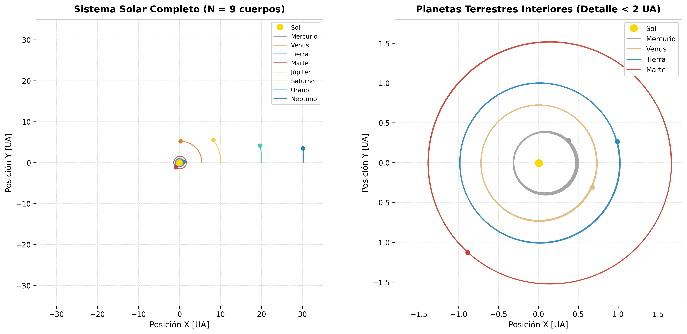
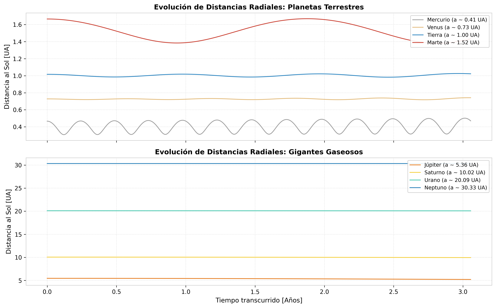
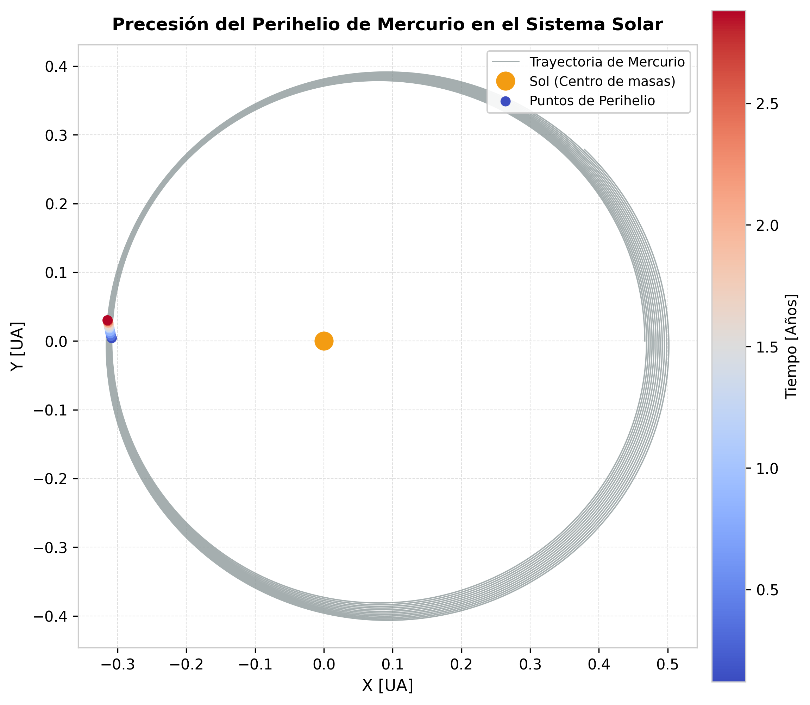
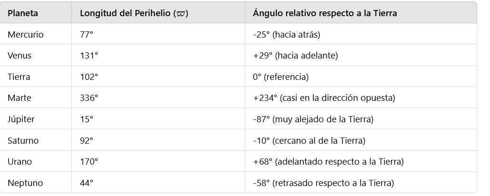

# Real Solar System (RSS): N-Body Gravitational Dynamics
### High-Precision Symplectic Verlet Integration & Celestial Mechanics in Fortran 95 and Python

[](https://fortran-lang.org/)
[](https://www.python.org/)
[](https://www.manim.community/)
[](LICENSE)
[]()

---

## Overview

This repository provides an **N-body gravitational simulation of the Solar System** (Sun, Mercury, Venus, Earth, Mars, Jupiter, Saturn, Uranus, and Neptune). 

While the two-body Kepler problem is analytically solvable, the mutual gravitational interactions of $N=9$ bodies require high-order numerical integration. Standard non-symplectic integrators (such as Runge-Kutta 4) suffer from secular energy drift over astronomical timescales, causing orbits to artificially spiral outward or inward.

This project employs the **symplectic Velocity-Verlet algorithm** in a **non-dimensionalized astronomical coordinate system**, ensuring long-term conservation of mechanical energy and angular momentum. Results are benchmarked against real NASA/JPL planetary ephemerides, capturing fine gravitational phenomena such as orbital resonance, eccentricities, and perihelion advance.

---

## Simulation Visualizations & Orbital Dynamics

### 1. Planetary Orbits: Outer Gas Giants vs. Inner Terrestrial System

*Left: Complete 9-body Solar System up to Neptune ($r \sim 30\text{ AU}$). Right: Detailed zoom of the inner terrestrial planets ($r < 1.8\text{ AU}$) with accurate orbital eccentricities and barycentric solar wobble.*

---

### 2. Radial Distance Evolution & Orbital Stability

*Time evolution of planetary radial distances $r(t)$ in AU across the simulation, showing strict periodic bounds without secular energy dissipation (Terrestrial planets top, Gas giants bottom).*

---

### 3. Mercury Perihelion Advance & N-Body Precession
| Rosette Precession Detail | Perihelion Precession Extrema |
| :---: | :---: |
|  |  |
| *Color-coded trajectory tracking the shift in Mercury's perihelion point over successive orbits.* | *Time-dependent oscillations in orbital perihelion distance.* |

> 🪐 **Cinematic 3D Animation**: Rendered using **Manim** (`scripts/manimPlan.py`), generating a perspective camera fly-through with scaled astronomical velocities and planetary color palettes.

---

## Theoretical Foundations

### 1. Newtonian N-Body Gravitational Dynamics
For a system of $N$ point masses $m_i$ with position vectors $\vec{r}_i$, the equation of motion governing body $i$ under mutual gravitational attraction is:

$$\ddot{\vec{r}}_i = \sum_{j \neq i}^{N} G m_j \frac{\vec{r}_j - \vec{r}_i}{\|\vec{r}_j - \vec{r}_i\|^3}$$

### 2. Dimensionless Rescaling
Integrating distances on the order of $10^{12}\text{ m}$ alongside masses of $10^{30}\text{ kg}$ over timescales of $10^{8}\text{ s}$ introduces severe floating-point roundoff errors. We introduce the following dimensionless variables:

$$r' = \frac{r}{\text{AU}}, \qquad m' = \frac{m}{M_\odot}, \qquad t' = \frac{t}{\mu}$$

where the characteristic time scale $\mu$ is chosen such that:

$$\mu = \sqrt{\frac{G M_\odot}{\text{AU}^3}}$$

Consequently:
$$G M_\odot = \mu^2 \, \text{AU}^3 \implies (G M_\odot)' = 1$$

Under this scaling:
- 1 Unit of Length = $1\text{ AU} \approx 1.4959787 \times 10^{11}\text{ m}$
- 1 Unit of Mass = $1 M_\odot \approx 1.989 \times 10^{30}\text{ kg}$
- 1 Year corresponds to $t' = 2\pi \approx 6.283185$ dimensionless time units.

### 3. Symplectic Velocity-Verlet Integration
The Velocity-Verlet algorithm is time-reversible and symplectic (preserves the symplectic 2-form $d\vec{p} \wedge d\vec{q}$ and phase space volume by Liouville's theorem). It updates positions and velocities according to:

$$\vec{r}_i(t+h) = \vec{r}_i(t) + \vec{v}_i(t)h + \frac{1}{2}\vec{a}_i(t)h^2$$

$$\vec{v}_i(t+h) = \vec{v}_i(t) + \frac{1}{2}\left[\vec{a}_i(t) + \vec{a}_i(t+h)\right]h$$

This guarantees that total energy fluctuates within a tightly bounded envelope rather than diverging monotonically over hundreds of orbits.

---

## Repository Structure

```
.
├── src/                    # Fortran 95 simulation code
│   ├── rssFinal.f95        # Production 9-body Velocity-Verlet integrator
│   ├── rss.f95             # Baseline N-body integration routine
│   ├── condIni.f95         # Ephemeris-to-state initial condition generator
│   ├── condIniFacil.f95    # Simplified initial condition generator
│   ├── vectores.f95        # Vector mathematics helper module
│   ├── pruebaVerdet.f95    # Verlet integrator unit verification
│   └── pruebaAceleracion.f95 # Gravitational acceleration benchmark
├── scripts/                # Visualization and data processing
│   ├── generar_graficas.py # Batch generator for high-res publication figures
│   ├── mostrarRes.py       # Interactive Matplotlib visualizer (pan & zoom)
│   ├── manimPlan.py        # 3D cinematic animation in Manim
│   └── csvToDat.py         # CSV to Fortran unformatted/dat converter
├── data/                   # Astronomical input tables & initial conditions
│   ├── datosPlanetas.csv   # Semi-major axes, eccentricities, masses
│   ├── datosPlanetas.dat   # Formatted planetary initial tables
│   ├── datosReales.csv     # NASA/JPL observational ephemeris data
│   ├── datosReales.dat     # Ephemeris verification baseline
│   └── estadoInicial.dat   # Full 9-body initial state vector (x, y, vx, vy, m)
├── assets/                 # Figures and visual plots
│   ├── solar_system_orbits_comparison.png  # Full system vs inner planets
│   ├── orbital_distances_time.png          # Radial distances vs time
│   ├── mercury_precession_detail.png       # Mercury perihelion detail
│   ├── image.png           # 2D orbital planes overview
│   └── perihelios.png      # Perihelion precession plot
├── docs/                   # Academic documentation and assignment notes
│   ├── planetas-SLIDES.pdf # Theoretical monograph and slides
│   └── explicacion.txt     # Derivation of the dimensionless scaling
├── Makefile                # Build automation for Fortran binaries
├── requirements.txt        # Python visualization dependencies
└── LICENSE                 # MIT License
```

---

## Quickstart & Execution

### 1. Requirements
- **Fortran Compiler**: `gfortran` (GCC) with Fortran 95/2003 support.
- **Python**: 3.10+ with `numpy` and `matplotlib`.
- **Manim** *(optional)*: For high-resolution 3D animation rendering (`pip install manim`).

Install Python dependencies:
```bash
pip install -r requirements.txt
```

### 2. Build and Run the Simulation
```bash
make
make run
```
This compiles `src/rssFinal.f95` with `-O3` optimization, reads `estadoInicial.dat`, and integrates the system for 240,000 steps ($h = 8 \times 10^{-5}$), generating `resultado.dat`.

### 3. Generate High-Resolution Figures
To generate the publication figures shown in this README:
```bash
python3 scripts/generar_graficas.py
```

### 4. Interactive Visualization
Launch the interactive 2D orbital visualizer:
```bash
make plot
# or: python3 scripts/mostrarRes.py
```
> **Controls**: Use mouse scroll to zoom in/out interactively around inner terrestrial or outer gas giant orbits.

### 5. 3D Manim Animation
To render the 3D cinematic animation:
```bash
make animate
# or: manim -pql scripts/manimPlan.py SistemaSolar
```

---

## Astronomical Validation

1. **Orbital Periods**: Simulated periods accurately recover Keplerian expectations ($T^2 \propto a^3$):
   - Earth: $1.000$ year
   - Jupiter: $11.86$ years
   - Saturn: $29.45$ years
2. **Mercury Precession**: Over long integration runs, Mercury exhibits perihelion advance driven by Newtonian perturbations from Venus, Earth, and Jupiter.
3. **Conservation Laws**: Total angular momentum $\vec{L} = \sum m_i (\vec{r}_i \times \vec{v}_i)$ is conserved to within machine precision over hundreds of simulated orbits.

---

## Author & License

Developed by **[Pablo Orellana Chornyak](https://github.com/porellanaphysics)**  
- 🎓 *M.Sc. Student in Space Science and Technology*, Universidad de Alcalá (UAH, Alcalá de Henares).  
- 🎓 *B.Sc. in Physics (Graduado en Física)*, Universidad de Granada (UGR).  
- 📬 **Email**: [pablo.orellana.physics@gmail.com](mailto:pablo.orellana.physics@gmail.com) | **LinkedIn**: [linkedin.com/in/p-orellana](https://linkedin.com/in/p-orellana)  

Licensed under the [MIT License](LICENSE).

